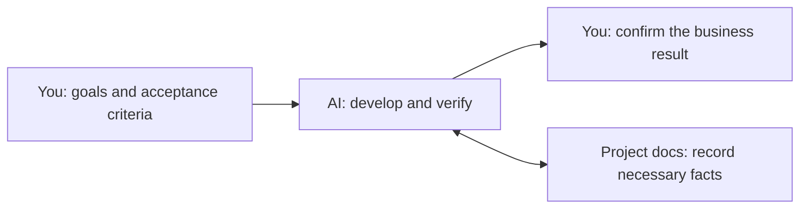
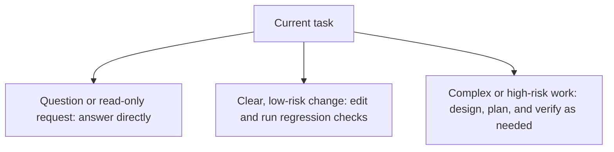

# Agentic Dev Workflow

[中文](README.md) | English

**Bring an AI development workflow into your project: let AI choose an approach for each task, verify changes, and leave project records you can resume from.**

For personal projects, starting from scratch or working with an existing codebase. Make simple changes directly, design and plan complex work as needed, and resume from documentation and real code in a new session.

Current version: `2.3.0`. Codex is the default; entry points for other tools are in the [usage guide](docs/USAGE-GUIDE.en.md).



## Get started in three minutes

**New project:**

1. [Download the template ZIP](https://github.com/Misayhuiyi/Agentic-dev-workflow/archive/refs/heads/main.zip) and copy its contents, including hidden directories, into your project root. You can also use GitHub's **Use this template**.
2. Open the project root in Codex or another AI development tool that can read files and edit code.
3. Send this request to AI, filling in your goals and constraints:

```text
Read AGENTS.md first and use the project's Skills as needed.
I want to build: [goal and users].
Start with: [one minimal flow that can run and be demonstrated].
Acceptance criteria: [how to judge whether the result meets expectations].
Constraints: [tech stack, environment, data permissions, time].
Check existing materials and boundaries first, then proceed within the currently authorized scope.
```

**Existing project:** Put the template in a separate directory first. Ask AI to inspect differences and propose a minimal merge. Preserve your product README, existing rules, directories, license, and uncommitted changes; do not overwrite them directly.

Markdown rules and Skills require no Python installation; only the optional helper scripts need Python.

After integration, the root README should describe your product. Project facts come from your product context and actual code.

## Day-to-day development

Describe the task directly; you do not need to memorize Skill names.

| Situation | A request you can send to AI |
| --- | --- |
| Develop or fix | “Complete [feature/problem]. Check the existing implementation and impact first, then run appropriate verification after the changes.” |
| Unclear requirements | “Help clarify the scope and acceptance criteria for [problem], and list the decisions I need to make.” |
| Confirm business results | “Give me the current candidate's run instructions, steps to try it, actual verification results, and unverified items for my review.” |
| Pause and resume | “Before pausing, save task [ID]'s state and next step. In the new session, check that task against the actual workspace before continuing.” |

The workflow follows the **risk and complexity of the current task**:



After a business module passes tests, you still need to confirm its actual results. Releases, production operations, and paid calls need the relevant authorization.

Research, prototypes, and PoCs are added when needed; see the [usage guide](docs/USAGE-GUIDE.en.md) for complete examples.

## Explore as needed

| What you want to understand | Where to look |
| --- | --- |
| Full usage, tool adapters, helper scripts, and upgrades | [Usage guide](docs/USAGE-GUIDE.en.md) |
| How AI should execute tasks | [AGENTS.md](AGENTS.md) |
| Product documentation, task records, and session continuity | [Documentation index](docs/README.md) |
| Maintaining the workflow framework itself | [Framework architecture overview](docs/WORKFLOW-ARCHITECTURE.md) |

**The framework architecture overview does not describe your product's architecture and is not required reading for product development.** Complete Skill bodies live in `.agents/skills/`; other tool entry points forward to this source.

The original `2.3.0` delivery recorded limited verification on Windows / Python 3.11.9 / a Codex host; see [verification scope and limitations](docs/USAGE-GUIDE.en.md#11-verification-scope-and-limitations). Check other tools and environments yourself. Rules and Skills guide behavior; tool permissions and production controls come from the actual environment.

## Sources and licenses

Original content uses the [Personal Development and Research License](.ai-workflow/LICENSE): private learning, development, and research by natural persons only. **Commercial and organizational use is prohibited.** This is a custom, source-available license.

Method Skills are based on pinned Superpowers `6.3.0`, with this project's patches. Third-party MIT content and prior grants retain their original licenses; UI metadata follows its source terms. See the [license scope](.ai-workflow/LICENSE-SCOPE.md) and [third-party notices](.ai-workflow/THIRD_PARTY_NOTICES.md). This project is not an official distribution of the related AI tools.
