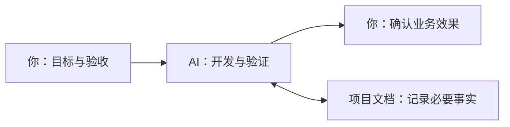
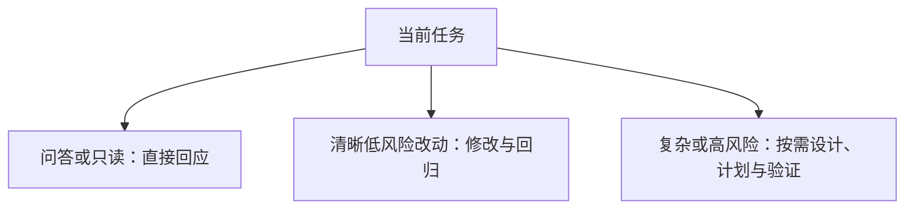

# Agentic Dev Workflow

中文 | [English](README.en.md)

**把一套 AI 开发协作流程放进你的项目，让 AI 按任务选择做法、验证改动，并留下可接续的项目记录。**

适合个人项目从零开发或接入已有代码库。小改直接做，复杂工作按需设计和规划，换会话从文档与真实代码继续。当前版本 `2.3.0`，默认面向 Codex，其他工具的入口见 [使用指南](docs/USAGE-GUIDE.md)。



## 三分钟开始

**新项目：**

1. [下载模板 ZIP](https://github.com/Misayhuiyi/Agentic-dev-workflow/archive/refs/heads/main.zip)，把内容复制到项目根目录，保留隐藏目录；也可使用 GitHub 的 **Use this template**。
2. 从项目根目录打开 Codex 或其他能读取文件、修改代码的 AI 开发工具。
3. 把下面的请求发给 AI，填入你的目标和约束：

```text
先读取 AGENTS.md，按需使用项目内 Skills。
我要开发：[目标和用户]。
先完成：[一个可以运行、演示的最小闭环]。
验收标准：[怎样判断效果符合预期]。
约束：[技术栈、环境、数据权限、时间]。
请先核对现有材料和边界，再推进当前获准的范围。
```

**已有项目：** 先把模板放在独立目录，让 AI 盘点差异并提出最小合并方案。保留业务 README、现有规则、目录、许可证和未提交修改，不直接覆盖。

使用 Markdown 规则与 Skills 无需安装 Python；只有可选辅助脚本需要 Python。接入后，根 README 应介绍你的产品，项目事实以业务上下文和真实代码为准。

## 日常开发怎么用

直接描述任务即可，不必记住所有 Skill 名称。

| 场景 | 可以这样发给 AI |
| --- | --- |
| 开发或修复 | “完成 [功能/问题]，先检查现有实现和影响范围，修改后运行适用验证。” |
| 需求还不清楚 | “先帮我明确 [问题] 的范围和验收标准，列出需要我决定的事项。” |
| 验收业务效果 | “给我当前候选的运行入口、体验步骤、实际验证结果和未验证项，供我确认。” |
| 暂停与继续 | “暂停前保存任务 [ID] 的状态和下一步；新会话先核对该任务与实际工作区再继续。” |

流程随**当前任务的风险与复杂度**变化：



业务模块的测试通过后，仍需你确认实际效果；发布、生产操作和付费调用需要相应授权。调研、原型和 PoC 只在确有需要时加入，完整示例见 [使用指南](docs/USAGE-GUIDE.md)。

## 按需深入

| 想了解什么 | 入口 |
| --- | --- |
| 完整用法、工具适配、辅助脚本与升级 | [使用指南](docs/USAGE-GUIDE.md) |
| AI 应怎样执行任务 | [AGENTS.md](AGENTS.md) |
| 业务文档、任务记录与跨会话接续 | [文档导航](docs/README.md) |
| 维护工作流框架本身 | [框架架构概览](docs/WORKFLOW-ARCHITECTURE.md) |

**框架架构概览不代表业务项目的架构，也不进入业务开发的必读链。** Skills 的完整正文在 `.agents/skills/`，其他工具入口转发到这份正本。

`2.3.0` 原交付记录了 Windows / Python 3.11.9 / Codex 宿主下的有限验证，详见 [验证范围与限制](docs/USAGE-GUIDE.md#11-验证范围与不能保证的事情)。其他工具与环境需自行核对；规则与 Skills 是行为约束，工具权限和生产控制由实际环境提供。

## 来源与许可

原创部分采用 [个人开发与研究许可](.ai-workflow/LICENSE)：仅限自然人的私人学习、开发与研究，**禁止商业及组织使用**。这是源码可见的自定义许可。

方法 Skills 基于锁定的 Superpowers `6.3.0` 并含本项目补丁。第三方 MIT 内容和既有历史授权保留原许可，UI 元数据按来源条款处理；详见 [许可范围](.ai-workflow/LICENSE-SCOPE.md) 与 [第三方声明](.ai-workflow/THIRD_PARTY_NOTICES.md)。本项目不是相关 AI 工具的官方发行包。
