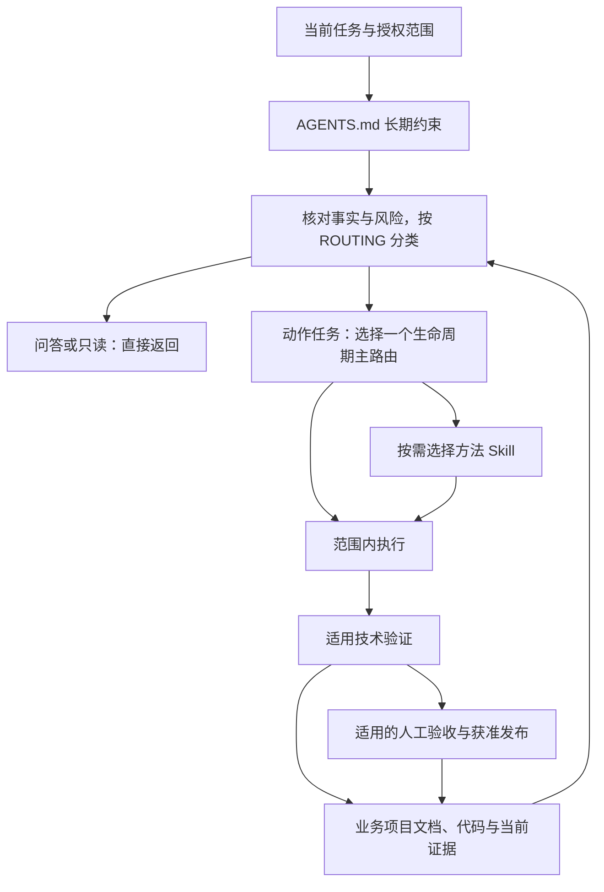

# Agentic Dev Workflow 架构概览

本文面向维护、扩展 **Agentic-dev-workflow 框架本身**的人和 AI，解释约束、路由、方法与文档如何协作。它是设计概览；执行约束以 [AGENTS.md](../AGENTS.md)、[路由合同](../.ai-workflow/ROUTING.md)及相关正本为准，不在这里维护另一套规则或任务状态。

**模板复制到业务项目后，本文仍描述工作流框架，不代表业务项目的架构、技术栈、需求或开发进度。** 使用模板开发业务时，读取该业务项目已有的 README、文档索引、项目上下文和真实代码；不能因为本文存在，就把当前任务认定为框架维护。只有当前任务明确涉及框架自身的设计或机制时，才按需读取本文相关部分。

## 1. 项目定位与边界

这个基座把长期 AI 协作中的三个问题连接起来：当前任务应采用什么流程、可以在什么范围内行动，以及换会话后如何从真实证据恢复。它通过简短常驻约束、按需加载的 Skills 和持久文档，减少上下文堆积、重复计划、越界推进与失真的完成声明。

它不替业务项目选择语言、框架、数据库或产品架构，不预建业务代码、CI 或生产设施，也不提供程序化权限执行、身份认证、自动调度或生产审批系统。Markdown 和 Skill 是行为约束；真实工具权限、凭据、预算和部署控制由宿主及项目环境提供。内容的许可边界另见 [许可范围](../.ai-workflow/LICENSE-SCOPE.md)。

## 2. 整体架构与协作关系

| 层次 | 职责 | 与其他层的关系 |
| --- | --- | --- |
| 人类使用入口 `README.md` | 介绍用途、接入方式、命令与已验证范围 | 帮助人找到入口，业务接入后改为业务首页 |
| AI 执行入口 `AGENTS.md` | 保留长期约束和按需路由入口 | 约束任务范围；不嵌入全部流程正文 |
| 生命周期 Skills | 按当前工作类型承担范围、事实与交付责任 | 当前只有一个主路由，必要专项工作返回该范围负责人 |
| Superpowers 方法 Skills | 提供设计、计划、测试、诊断、审查等具体方法 | 在主路由中按复杂度、风险或明确请求选择，不接管项目授权 |
| 文档与证据系统 | 保存上下文、唯一合同、任务状态和实际验证 | 为当前判断与跨会话恢复提供事实，不通过文件存在自动启动工作 |
| 框架架构概览 | 解释上述层次的设计与连接方式 | 维护框架时按需查阅，不作为下游业务架构入口 |



框架当前包含 11 个生命周期 Skill、14 个方法 Skill。生命周期回答“本次工作由谁负责、需要哪些事实”，方法回答“当前阶段怎样做”。方法中的 `superpowers:<name>` 指项目内同级正本；同名全局插件是另一来源，不能假定其版本或触发条件一致。优先级与集成边界见 [路由合同](../.ai-workflow/ROUTING.md)和 [Superpowers 兼容合同](../.ai-workflow/superpowers-compat.md)。

## 3. 核心运行机制

1. **识别当前任务。** 区分问答、只读检查、文档、实现、验收、维护、发布和事故；历史 pending 或未完成计划不能替代当前用户请求。
2. **核对五类风险。** 判断需求清晰度、交互不确定性、技术/数据/集成不确定性、权限/资金/隐私/生产暴露，以及影响范围与恢复成本。代码行数和项目大小不能代替风险判断。
3. **选择加载深度。** 普通问答不加载生命周期或方法；明确的低风险动作由匹配生命周期完成修改及验证。重要设计未决、复杂依赖、诊断困难或高风险时，才选当前阶段需要的方法，避免整库加载。
4. **执行已授权范围。** 复用既有实现、合同和有效决定，保护其他修改；支持方法不能增加外部写入、生产操作或费用权限。需求、证据或风险实质改变时，只暂停受影响的依赖工作。
5. **验证并保存必要事实。** 检查结果绑定当前候选及真实环境，失败与未执行项明确列出；技术通过、人工接受、发布和运行效果分别记录。需要恢复时留下最小任务状态，当场完成的小改不强制新增日志。

路由选择可以随证据变化调整：清晰文档改动走 `maintaining-project-docs`；未知的普通非生产 Bug 由 `project-development` 负责，初步查证后仍难定位才采用诊断方法；实际生产事故优先 `project-incident-response`。组合风险仍保留一个当前范围负责人，不把每个辅助方法变成新流程。

## 4. 生命周期与阶段衔接

生命周期是可裁剪、可回退的活动模型，阶段与 Skill 并非一一对应。下表说明常见衔接；完整的触发、合同与停止条件以 [交付活动参考](../.ai-workflow/references/delivery-loop.md)为准，简单任务无需逐阶段补齐文档。

| 活动 | 输入与产物 | 推进依据 |
| --- | --- | --- |
| 需求与证据 | kickoff 核对用户、问题、边界与验收；需要且获准时 research 提出有来源的建议 | 已有事实足够，或用户接受的建议进入唯一 spec/plan；候选建议不自动成为需求 |
| 设计与原型 | 在原 spec 中明确接口、数据、架构及取舍；交互未知时用原型澄清 | 所需设计决定已取得；原型认可只证明被观察的交互，不证明真实集成 |
| 技术 PoC/Spike | 关键假设需要实测时，由 verification 使用有界样本、阈值、预算与停止条件 | 结果支持被测范围，据此继续、调整、缩范围或停止；研究许可不自动授权实验 |
| MVP 与里程碑 | 在已有合同中选择最小可用业务闭环，复杂工作用一份计划拆成纵向切片 | 缩减范围而保留当前范围的质量门槛；近处详细、远处可调整 |
| 开发与集成 | development 在已批准切片内复用、实现、同步相关测试和文档 | 当前候选具备可运行的闭环与适用回归证据，不因计划存在推进未获准切片 |
| 测试与人工验收 | 当前任务完成普通验证；专项审查、Eval 和业务验收由 verification 处理 | 技术通过不等于人类接受；需要人工验收的候选未获接受时仍保持活动状态 |
| 发布与恢复 | release 核对环境、发布权限、迁移及回退；真实操作留下证据 | 仅在所需授权和前置条件具备时执行；合并、部署、放量与稳定运行分别判断 |
| 维护与反馈 | maintenance 处理依赖和迁移，docs 同步事实，continuity 恢复交接；事故进入 incident-response | 根据真实运行或验证反馈开启获准的下一任务，保留兼容与恢复证据 |

产品原型与技术 PoC 可以回答不同问题，不能互相替代，也都不是必经阶段。安全、测试与恢复准备贯穿设计和各切片。发生验收失败、关键假设不成立或超预算时，应回到受影响的合同与决定点，而不是创建第二套计划。

## 5. 关键模块、目录与权威来源

| 路径 | 权威职责或派生关系 |
| --- | --- |
| [`AGENTS.md`](../AGENTS.md) | 常驻约束与路由入口；区分框架维护和业务开发的读取范围 |
| [`.ai-workflow/ROUTING.md`](../.ai-workflow/ROUTING.md) | 任务分类、主路由、加载深度及跨阶段条件的详细合同 |
| [`.agents/skills/`](../.agents/skills/) | 完整 Skill 的唯一正本；相对参考路径从各正本目录解析 |
| [`.ai-workflow/superpowers-compat.md`](../.ai-workflow/superpowers-compat.md) | 方法与项目授权、任务状态、宿主能力的兼容合同 |
| [`CLAUDE.md`](../CLAUDE.md)、[`GEMINI.md`](../GEMINI.md)、[`.claude/skills/`](../.claude/skills/) | 生成的导入或转发入口，不维护另一套规则正文 |
| [`.ai-workflow/scripts/sync_adapters.py`](../.ai-workflow/scripts/sync_adapters.py) 与 [`ADAPTERS.lock.json`](../.ai-workflow/ADAPTERS.lock.json) | 生成计划及来源/目标指纹；发现人工改动时报告冲突，不靠覆盖解决 |
| [`.ai-workflow/scripts/project_status.py`](../.ai-workflow/scripts/project_status.py) | 只读检查任务选择、工作区、证据新鲜度和完成记录，生成可读快照；不是审批或调度器 |
| [`docs/README.md`](README.md) 与 [`.ai-workflow/templates/`](../.ai-workflow/templates/) | 业务文档职责、读取/归档约定及按需使用的记录模板；模板不是当前业务事实 |
| [`.ai-workflow/SOURCES.lock.json`](../.ai-workflow/SOURCES.lock.json) 与 [`third_party/`](../.ai-workflow/third_party/) | 锁定来源、上游版本、许可、补丁与分发哈希；不授予项目行动权限 |
| `docs/WORKFLOW-ARCHITECTURE.md` | 框架设计概览，链接上述正本；不维护业务合同、状态或第二套执行规范 |

业务项目中，代码和配置定义实际实现，原 spec/PRD 定义批准意图，plan 定义实施分解，任务文件首行机器块保存唯一动态状态；索引只指向任务，可读快照从状态生成。`project-context` 是简短事实入口，不复制进度台账。框架架构文档不能替代这些来源，冲突应回到对应正本核实。

## 6. 扩展、修改与兼容验证

**新增 Skill。** 先确认现有路由和参考能否承载需求。新增确有独立职责的 Skill 时，在正本目录写清名称、触发/不触发条件、输入、范围、输出与必要引用，避免与既有入口重叠。下游业务专用 Skill 不代表框架新增内置能力；当前生成器的 `--allow-extra-skills` 仅容纳额外 Skill 并管理原内置适配集合，不自动给新 Skill 生成代理。框架新增内置 Skill 需同步生成器内置集合、适配输出、计数和验证。

**修改路由。** 从 `AGENTS.md`、`ROUTING.md` 和相应 Skill 的实际触发条件入手，避免仅改描述却保留相反的执行边界。检查只读问答、清晰小改、复杂实现、高风险动作及生产事故是否仍进入正确路线；方法嵌套调用仍要受当前阶段和授权范围约束。框架文档的读取不能升级成所有业务任务的前置步骤。

**调整文档体系。** 先明确哪类事实归哪个唯一来源，再改导航、模板、引用及实际读取者。改变任务机器块或可读快照格式时，核对 `project_status.py`、`_taskstate.py` 和已有记录的兼容行为；不能只改文档样例就宣称解析器支持新格式。保留已有业务项目的合理路径，避免复制后出现两份 spec、计划或动态状态。

**修改正本并同步适配。** 在目标仓库根目录先预览生成计划，确认范围后应用并检查：

```text
python .ai-workflow/scripts/sync_adapters.py --root .
python .ai-workflow/scripts/sync_adapters.py --root . --apply
python .ai-workflow/scripts/sync_adapters.py --root . --check
```

修改 `AGENTS.md` 即使没有改变代理正文，也会改变根适配器的来源指纹；用生成器同步锁，不手工伪造哈希或修改代理来掩盖正本问题。遇到人工改动冲突时，核对差异并保护现有内容。

验证应覆盖实际影响：文档改动检查链接、来源一致性和适配锁；路由/Skill 行为变化核对正反触发场景；解析器和脚本变化运行适用回归；方法升级比较锁定来源、现有补丁和分发哈希，并保留许可声明。静态链接和生成检查不能证明所有 AI 宿主的读取行为，需要宿主行为证据时另行验证，未执行则明确说明。

框架维护完成后同步概览与人类入口，但不把开发测试夹具、历史日志或框架状态复制成下游业务事实。下游接入时以业务 README 和真实上下文为入口；即使保留本概览，也只将其作为工作流组件的设计参考。
